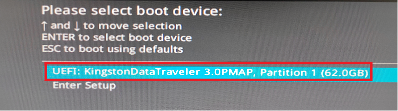
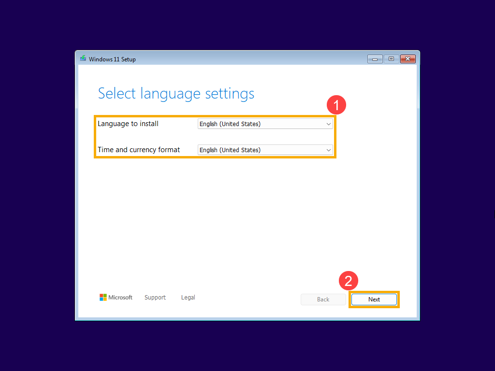
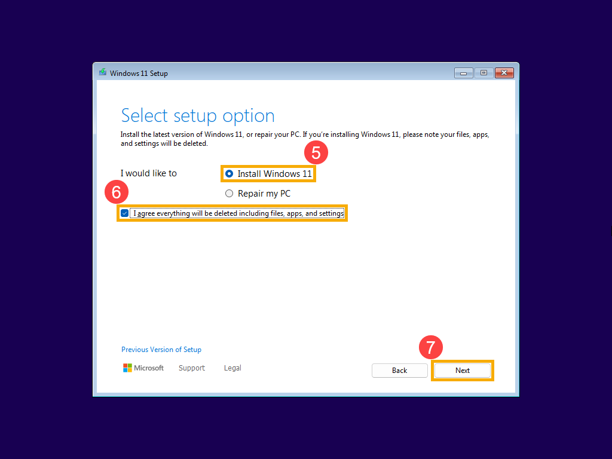
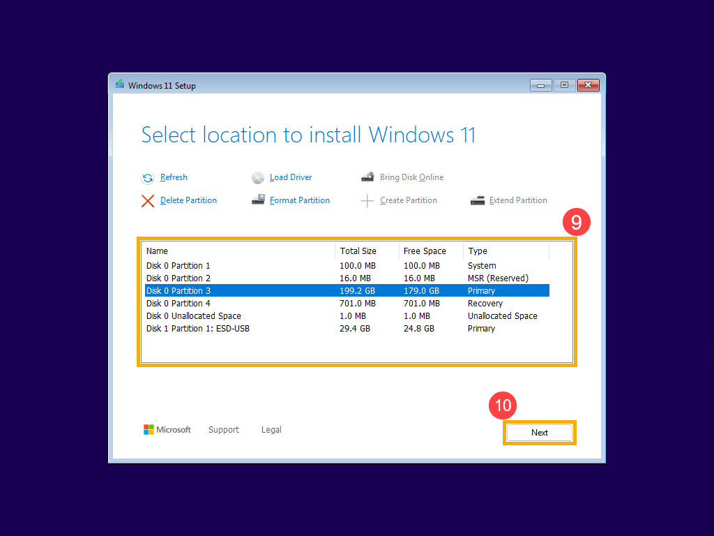
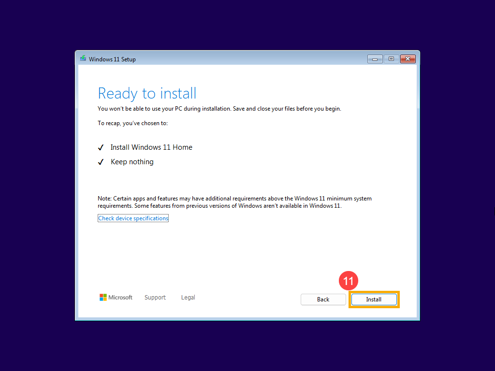

# 🖥️ Как установить Windows и Office

**Установочная флешка уже готова.** Понадобятся компьютер, клавиатура и эта флешка. Начинаем с запуска установки.

> [!CAUTION]
> **Перед началом**
> Если на компьютере есть нужные фото, документы или другие файлы, сначала скопируй их на отдельный накопитель или в облако. Удаление разделов при установке сотрёт данные. Копия в соседней папке того же диска не защитит от удаления.


## 1 · Вставь флешку и открой меню загрузки

1. Выключи компьютер через **Пуск → Питание → Завершение работы**.
2. Вставь готовую флешку в USB-разъём **на системном блоке**, желательно сзади. Не в монитор. Другие внешние накопители отсоедини.
3. Включи компьютер и сразу несколько раз нажимай кнопку меню загрузки. На первом экране рядом со словами **Boot Menu** может быть написана нужная клавиша.
4. В появившемся меню стрелками выбери **UEFI: название флешки** и нажми **Enter**. Название может содержать USB, Kingston, DEXP или другую марку.
5. Если появится **Press any key to boot from USB**, сразу нажми пробел один раз.
6. Дождись окна установки Windows с выбором языка.

Частые варианты для стационарного ПК:

- **MSI — F11.**
- **Gigabyte — F12.**
- **ASUS — обычно F8;** также можно зайти в BIOS через Delete / F2 и найти Boot Menu.
- **Dell — F12.**
- **HP — Esc, затем F9.**

Если не знаешь производителя, посмотри логотип при включении. Эти кнопки зависят от материнской платы или модели ПК. Если Windows уже загрузилась, перезагрузи компьютер и попробуй снова. Нажимай одну выбранную клавишу, а не все подряд.


**Пример настоящего Boot Menu на плате ASUS.** Выбери строку, начинающуюся с **UEFI:** и содержащую название флешки, затем нажми Enter. На другом ПК оформление будет отличаться.



Источник: [руководство ASUS по установке Windows 11](https://www.asus.com/global/support/faq/1046970/).

> [!NOTE]
> **Что такое Boot Menu**
> Это меню выбора, откуда включить компьютер: с внутреннего диска или с флешки. Для установки выбираем флешку. После установки компьютер будет запускаться с внутреннего диска.

### Если открывается только BIOS

Вход в BIOS на многих ПК — **Delete**, иногда **F2**. Нажимай сразу после включения.

1. Найди **Boot Menu** или **Boot Override** — названия могут находиться во вкладке Boot или Exit.
2. Выбери **UEFI: название флешки**. Компьютер должен запустить установщик.
3. Если не можешь найти этот пункт, ничего не меняй наугад. Сфотографируй экран. Для выхода без изменений используй **Exit Without Saving / Discard Changes and Exit**.

Не переключай режимы диска RAID / VMD / SATA и не отключай защитные настройки ради эксперимента.

### Если старая Windows работает — можно проще

1. Вставь флешку и открой **Пуск → Питание**.
2. Зажми **Shift**, нажми **«Перезагрузка»** и дождись синего экрана.
3. Выбери **«Использовать устройство» → EFI USB Device / UEFI: название флешки**.
4. Если этого пункта нет: **«Поиск и устранение неисправностей» → «Дополнительные параметры» → «Параметры встроенного ПО UEFI» → «Перезагрузить»**. Затем найди Boot Menu / Boot Override.

> [!TIP]
> **Флешка не появилась?**
> Попробуй другой USB-разъём сзади системного блока, затем выключи и снова включи ПК. Если не помогает, сфотографируй меню — не форматируй готовую флешку.

## 2 · Выбери: удалить данные или сохранить

- **Можно удалить всё на диске с Windows:** продолжай по **варианту А** ниже.
- **Нужно сохранить файлы:** сначала прочитай **вариант Б**. Не удаляй разделы, пока нет проверенной копии.
- **Нужно оставить ещё и программы:** используй **Б1** из работающей Windows. Для этого загружаться с флешки не нужно.

## Вариант А · Чистая установка — удалить всё на выбранном диске

> [!CAUTION]
> **Точка невозврата**
> Продолжай только после проверки резервной копии. Далее удаляются разделы **целевого физического диска**. Это может затронуть и C:, и D:, если они находятся на одном SSD, а также заводское восстановление. На другом диске ничего удалять не нужно.

### Первые экраны установки

1. Выбери русский язык, регион и раскладку клавиатуры → «Далее».
2. Выбери **«Установить Windows 11» / «Установить»**. В новом установщике для чистой установки может потребоваться согласие с удалением файлов, приложений и настроек — это относится к этому сценарию.
3. Если есть запрос ключа: введи свой ключ либо выбери **«У меня нет ключа продукта»**. Прежняя цифровая лицензия может активировать ту же редакцию после подключения к интернету.
4. Если есть список редакций, выбери соответствующую лицензии, обычно **Windows 11 Домашняя** или **Pro**. Не выбирай Pro только потому, что название кажется лучше.
5. Прими условия, если согласен с ними.
6. Если спрашивают тип установки, выбери **«Выборочная: только установка Windows»**. В новых версиях установщика отдельного такого экрана может не быть.

### Как выглядят первые экраны

На этих скриншотах интерфейс английский. В русской версии **Next = «Далее»**, **Install Windows 11 = «Установить Windows 11»**. Красные рамки и номера уже нанесены в руководстве ASUS.

**Выбор языка.** У себя выбери русский язык и нажми «Далее» внизу справа. Затем выбери раскладку клавиатуры.



**Начало чистой установки.** Выбери «Установить Windows 11». Галочку согласия с удалением ставь только в варианте А, когда нужные файлы уже сохранены. Затем нажми «Далее».



### Выбор диска — самый внимательный этап

**Так выглядит экран выбора диска в новом установщике Windows 11.** На нём есть список разделов и кнопка **Delete Partition — «Удалить раздел»**. Сначала прочитай все пять шагов ниже. Номера дисков на картинке — только пример.



1. Найди внутренний диск, на который ставишь Windows, по **модели и полному объёму**. Например, SSD на 512 ГБ может отображаться примерно как 476 ГБ.
2. Не ориентируйся только на «Диск 0»: номера и буквы могут измениться. Если внутренних дисков несколько и определить нужный не получается — **остановись**.
3. По одному выделяй разделы **только выбранного диска** → **«Удалить раздел» / «Удалить»** → подтверждение. У него могут быть разделы «Система», MSR, «Основной», «Восстановление».
4. Когда на выбранном диске останется одна строка **«Незанятое пространство»**, выдели её и нажми **«Далее»**.
5. Windows сама создаст необходимые разделы и отформатирует их. Отдельно нажимать «Форматировать» после удаления не требуется.

**Пример:** если целевой SSD — «Диск 1», удаляются разделы диска 1. Разделы диска 0 трогать нельзя. Картинка выше условная, её номера нельзя переносить на свой компьютер.

### Последнее подтверждение

В новом установщике после выбора диска может появиться экран **Ready to install — «Всё готово к установке»**. Для варианта А проверь выбранную редакцию и предупреждение об удалении, затем нажми **Install — «Установить»**. В старом установщике отдельного подтверждения может не быть.



Скриншоты установки: [официальное руководство ASUS](https://www.asus.com/global/support/faq/1039507/). Вид окон зависит от версии Windows; названия действий важнее их положения на картинке.

### Пока идёт установка

1. Дождись копирования файлов. Не отключай питание.
2. Во время первой автоматической перезагрузки больше не нажимай клавиши для запуска с USB. Компьютер должен продолжить с внутреннего диска.
3. Если снова открылся самый первый экран установки, ничего не удаляй повторно. Перезагрузи компьютер, убери установочную флешку и выбери **Windows Boot Manager** внутреннего SSD в Boot Menu.
4. Пройди первоначальную настройку: страна → раскладка → сеть → учётная запись → PIN → параметры конфиденциальности. Экраны зависят от редакции и версии; следуй подсказкам.

> [!TIP]
> **Windows установлена**
> Ты видишь рабочий стол, меню «Пуск» открывается, компьютер запускается без установочной флешки. Теперь переходи к разделу 3.

## Вариант Б · Если нужно оставить данные

### Б1 · Сохранить файлы, программы и настройки

**Условие:** старая Windows запускается. Установщик на флешке должен подходить по языку, архитектуре и редакции, а его версия — поддерживать обновление текущей системы.

1. Сделай резервную копию и освободи место на системном диске; ориентир — несколько десятков гигабайт, точный объём проверит установщик.
2. Оставаясь в обычной Windows, открой «Этот компьютер», затем установочную флешку.
3. На флешке запусти **setup.exe**.
4. Следуй подсказкам. На экране «Готово к установке» открой **«Изменить выбранные для сохранения компоненты»**, если это необходимо.
5. Обязательно выбери **«Сохранить личные файлы и приложения»**. Убедись, что именно это написано на итоговом экране, и только затем нажми «Установить».
6. Дождись завершения и проверь свои файлы и программы.

> [!CAUTION]
> **Пункта сохранения приложений нет?**
> Отмени установку. Не выбирай «Ничего» в надежде, что файлы останутся. Причиной может быть несовпадение языка / редакции / архитектуры или попытка поставить более старую версию. Загрузка с флешки не даёт этот сценарий сохранения программ.

### Б2 · Оставить файлы, но получить чистую Windows

1. Скопируй нужные файлы на внешний накопитель или в облако.
2. Открой копии и проверь их.
3. Отсоедини накопитель с копией.
4. Выполни **вариант А**.
5. После появления рабочего стола подключи накопитель и верни файлы. Программы установи заново.

Если нужно оставить отдельный раздел с файлами на том же SSD, нельзя удалять все разделы диска. Буквы в установщике меняются, и универсального безопасного правила «оставь D:» нет. Для новичка предпочтительнее сначала вынести данные наружу. Не рассчитывай на Windows.old как на резервную копию.

### Б3 · Windows не запускается, файлы нужны

**Пока не удаляй и не форматируй разделы.** Сначала нужно скопировать данные: через восстановление системы, подходящую загрузочную среду либо подключение SSD к другому компьютеру. При шифровании понадобится ключ BitLocker. Если не уверен, попроси помочь со спасением данных; к установке вернись после проверки копии.

## 3 · Сразу после установки

1. Подключись к интернету. Если Wi-Fi отсутствует, установи подготовленный драйвер производителя; временно может помочь Ethernet или USB-модем телефона.
2. Открой **Параметры → Центр обновления Windows → Проверить наличие обновлений**. Установи обновления, перезагрузи компьютер и повторно проверь их.
3. Драйверы бери из Windows Update и с сайта производителя точной модели. Случайные «сборники драйверов» не нужны.
4. Проверь звук, Wi-Fi, тачпад и яркость.
5. Посмотри **Параметры → Система → Активация**. Если написано «Активно», дополнительных действий не требуется.

## 4 · Установка Office с указанного сайта

**Страница:** [massgrave.dev/office_c2r_links](https://massgrave.dev/office_c2r_links#russian-ru-ru).

На ней собраны ссылки на установщики Microsoft. **Скачивание и установка не предоставляют лицензию:** продукт выбирай по имеющейся лицензии / подписке либо осознанно используй отдельный раздел 5 о MAS.

### Какой пункт выбрать

### Word, Excel и PowerPoint по подписке Microsoft 365

Russian [ru-RU] → Microsoft 365 / Sub → O365AppsBasicRetail

### Расширенный набор Microsoft 365

Russian [ru-RU] → Microsoft 365 / Sub → O365ProPlusRetail

### Постоянная лицензия Office 2024

Russian [ru-RU] → Office 2024 → продукт своей лицензии; Home2024Retail для «Для дома», HomeBusiness2024Retail для «Для дома и бизнеса»


**Простой пример для Word / Excel / PowerPoint:** выбери `O365AppsBasicRetail`, если тебе подходит Microsoft 365. Это пример комплекта, а не утверждение, что подписка уже есть.

### Установи выбранный комплект

1. Открой страницу выше в браузере.
2. Найди заголовок **Russian [ru-RU]**. Можно нажать **Ctrl + F**, ввести `Russian` и нажать Esc после поиска.
3. Выбери нужную вкладку: например, **Microsoft 365 / Sub**.
4. Найди строку нужного продукта, затем в ней нажми **Link в столбце Online x64**. Для обычного компьютера с Windows 11 на Intel / AMD подходит x64. x32 — другой столбец, не номер версии Office.
5. Открой скачанный установщик Microsoft и подтверди запуск, проверив издателя **Microsoft Corporation**.
6. Не отключай интернет и дождись сообщения об окончании установки.
7. Открой «Пуск», напечатай **Word** и запусти его. Аналогично можно найти Excel и PowerPoint.
8. Для лицензированной активации войди в учётную запись, к которой привязана подписка или покупка, либо введи подходящий ключ по подсказкам Office. Новый розничный ключ обычно привязывается через [setup.office.com](https://setup.office.com/).
9. Проверь **Word → Файл → Учётная запись → Сведения о продукте**.

> [!TIP]
> **Если онлайн-установщик не скачивает файлы**
> На той же странице для некоторых комплектов есть **Offline x32-x64**. Скачай его, подключи образ двойным нажатием и запусти setup.exe внутри. Для O365AppsBasicRetail офлайн-ссылка может отсутствовать (NA). Офлайн-образ может быть старее — после установки проверь «Файл → Учётная запись → Параметры обновления → Обновить».

> [!WARNING]
> **Если Office уже установлен**
> Сначала проверь, нельзя ли просто активировать существующий комплект. Не устанавливай одновременно разные разрядности Office. При конфликте удали ненужную старую версию через «Параметры → Приложения → Установленные приложения», перезагрузи компьютер и повтори установку. Перед удалением сохрани данные Outlook и нужные настройки. Для ошибок на сайте есть раздел Error in Office Installation — не запускай глубокую очистку Scrub ALL без понимания, какие продукты она удалит.

## 5 · Активация: обычный способ и MAS

### Сначала проверь лицензию

- **Windows:** Параметры → Система → Активация. Подключись к интернету, используй прежнюю редакцию. При наличии ключа — «Изменить ключ продукта»; при проблеме цифровой лицензии — средство устранения неполадок.
- **Office:** Word → Файл → Учётная запись. Войди в нужный аккаунт с лицензией / подпиской. Если указано, что продукт активирован, ничего дополнительно запускать не нужно.

### MAS — инструкция с massgrave.dev

Это сторонний способ изменения состояния активации, **не выдача лицензии Microsoft**. Он запускает скачанный из интернета код с возможным запросом прав администратора. Используй только если понимаешь и принимаешь этот способ; команды ниже здесь приведены как инструкция, на твоём ПК они не запускались.

1. Установи Windows / Office и подключись к интернету.
2. Открой именно [https://massgrave.dev/](https://massgrave.dev/) и найди **Activation Methods → Method 1: PowerShell**. Сверь команду с сайтом: она может измениться со временем.
3. Нажми «Пуск», напечатай **PowerShell** и открой **Windows PowerShell**.
4. На момент подготовки инструкции сайт предлагает следующую команду. Скопируй строку целиком, вставь в PowerShell через Ctrl + V и нажми Enter:

```powershell
irm https://get.activated.win | iex
```

5. Если появится запрос администратора, продолжай только если он вызван этим запуском и ты согласен дать скрипту права.
6. В меню выбирай **по названию**, а не по номеру из чужой инструкции: номера могут меняться. На сайте для Windows указан метод **HWID**, для Office — **Ohook**. Нажми цифру, показанную рядом с нужным пунктом, и следуй его подсказкам.
7. Дождись сообщения о результате. Если есть ошибка, запиши её текст и открой раздел Troubleshoot на сайте. Не отключай защиту Windows и не добавляй исключения только ради прохождения ошибки.
8. Закрой окно. Перезапусти Word и проверь **Файл → Учётная запись**; Windows проверь через **Параметры → Система → Активация**.

> [!NOTE]
> **Что делает команда**
> `irm` получает содержимое по адресу, `iex` сразу выполняет его. Не заменяй домен на похожий и не запускай команды из комментариев или рекламы. Если способ заблокирован, на главной есть Method 2 с файлом скрипта; скачивание само по себе не означает, что его нужно запускать, игнорируя предупреждения.

## 🛠 Если что-то пошло не так

### Установщик не видит SSD

Остановись. Проверь наличие SSD в BIOS; для некоторых моделей нужен драйвер Intel RST / VMD с сайта производителя и кнопка «Загрузить драйвер» в установщике

### «Компьютер не соответствует требованиям»

Проверь совместимость Windows 11 и настройки TPM / Secure Boot по инструкции модели. Не меняй их наугад

### Windows просит драйвер сети

Установи заранее скачанный драйвер с USB; при необходимости подготовь его на другом ПК

### Снова началась установка с флешки

Убери флешку при перезагрузке и выбери внутренний Windows Boot Manager; разделы повторно не удаляй

### Не предлагается сохранение приложений

Отмени установку и проверь совместимость образа с текущей Windows

### Диск просит ключ BitLocker

Найди сохранённый ключ. Не форматируй диск, если нужны файлы

### Office просит лицензию

Установка прошла, но активация ещё не завершена. Смотри раздел 5


## ✅ Последняя проверка

- [ ] Компьютер запускается без флешки.
- [ ] Нужные файлы сохранены и открываются.
- [ ] Работают интернет, звук, клавиатура и тачпад.
- [ ] Обновления Windows установлены.
- [ ] Word и Excel запускаются; состояние активации проверено.
- [ ] Копия файлов остаётся на внешнем носителе, пока не убедишься, что всё восстановлено.

## 🔗 Проверенные страницы и дата

Обновлено **20 октября 2026 года**. Скриншоты взяты из руководств ASUS; это примеры интерфейса, а не снимки твоего компьютера. Интерфейсы зависят от модели и сборки Windows.

- [Microsoft: переустановка с установочного носителя](https://support.microsoft.com/en-US/Windows/Deployment/Install-Upgrade/reinstall-windows-with-the-installation-media)
- [Microsoft: активация Windows](https://support.microsoft.com/en-us/windows/activation/activate-windows)
- [Microsoft: активация Office](https://support.microsoft.com/en-us/microsoft-365-activation-licensing/office-install/activate-office-for-windows)
- [ASUS: загрузка с USB](https://www.asus.com/global/support/faq/1013017/)
- [MSI: загрузка с выбранного устройства](https://us.msi.com/support/technical_details/MB_Boot_OS_Entry)
- [Gigabyte: клавиши меню загрузки и BIOS](https://download.gigabyte.com/FileList/Manual/desktop_pc_manual_ai-top-100-z890_1005_e.pdf)
- [Dell: BIOS и меню загрузки](https://www.dell.com/support/kbdoc/en-us/000126121/access-uefi-bios-system-setup-from-windows-on-your-dell-system)
- [HP: запуск и выбор устройства](https://support.hp.com/in-en/document/ish_6930187-6931079-16)
- [Установщики Office: указанная пользователем страница](https://massgrave.dev/office_c2r_links)
- [MAS: указанная пользователем главная страница](https://massgrave.dev/)

> [!NOTE]
> **Оформление**
> Цветные блоки вида `[!warning]` отображаются в Obsidian. Рядом с этим файлом есть HTML-версия с теми же разделами и цветами: её можно открыть обычным браузером. При переносе Markdown сохрани рядом папку **images**.
